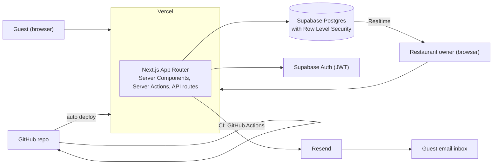
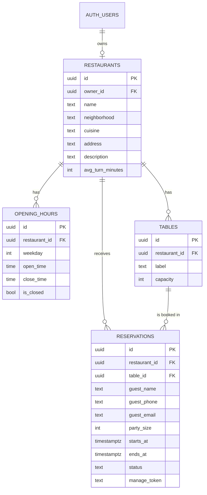

# TableNook


Free online reservations for small independent restaurants in the fictional city
of Maple Bay. Guests search, book a table without an account and get a confirmation
email; restaurant owners sign up, set up their restaurant and tables, and see
bookings live.

| | |
|---|---|
| **Live demo** | https://local-reservations.vercel.app/ |
| **Demo video** | [Google Drive](https://drive.google.com/drive/folders/1N3JnIMRroymi5Iz-60_HZQLakCgY0o73?usp=drive_link) |
| **Scrum board** | https://github.com/users/Joynana5/projects/12 |
| **API docs** | [docs/openapi.yaml](docs/openapi.yaml) |
| **Docs** | [PRD](docs/PRD.md) · [Design](docs/DESIGN.md) · [Sprint 1](docs/sprints/sprint-1.md) · [Sprint 2](docs/sprints/sprint-2.md) · [Contribution log](docs/contributions.md) | [Reflection](docs/reflection)

## Roles and features

| Role | Features |
|---|---|
| **Guest** (no account) | Search by neighborhood, date, time and party size with live availability · book a table · confirmation email with a manage link · cancel a booking from the link |
| **Restaurant owner** (account) | Sign up, log in, log out · set up profile, opening hours and tables · live reservation dashboard with status changes (Seated, No-show, Cancelled) |

**Real-time:** new bookings appear on the owner's dashboard without a page reload
(Supabase Realtime).

**Reliability:** availability is re-checked on the server before saving, and a Postgres
exclusion constraint makes double booking of the same table impossible.

**Known limitations:** the waitlist stories (US-7 to US-9) were moved to the backlog;
manage links do not expire yet; Supabase "Confirm email" is off for the demo.

## Tech stack

Next.js (App Router) · TypeScript · Tailwind CSS · Supabase (Postgres, Auth, RLS, Realtime) ·
Resend · Zod · Vitest · Playwright · GitHub Actions · Vercel.
Exact versions are pinned in `package.json`.

## Architecture



Business logic lives in `lib/` as plain, tested functions (availability rules, booking,
cancellation, validation). The UI calls it through Server Actions (`lib/actions/`), and
the public API calls the same functions through route handlers (`app/api/`), so both
always behave the same way.

```
app/(guest)/        guest pages: home, search, restaurant, booking, manage booking
app/(restaurant)/   owner pages: signup, login, setup, dashboard
app/api/            public REST API
lib/                business logic, validation (Zod), email, Supabase clients
supabase/           migrations and Maple Bay seed data
e2e/                Playwright tests
docs/               PRD, design, OpenAPI spec, sprint docs, contribution log
```

## Database schema



Row Level Security is enabled on every table: guests can read public restaurant data
only, and an owner can read and change only their own restaurant's data.

## Public API

The full contract is in [docs/openapi.yaml](docs/openapi.yaml) (OpenAPI 3.1; paste it into
[Swagger Editor](https://editor.swagger.io) to browse it interactively).

| Method | Endpoint | Purpose |
|---|---|---|
| GET | `/api/restaurants?date&time&partySize&neighborhood` | Search restaurants with a free table |
| GET | `/api/restaurants/{id}/availability?date&partySize` | All slots of a day, free or booked |
| POST | `/api/reservations` | Book a table (400 invalid, 409 slot taken, 422 unavailable) |
| DELETE | `/api/reservations/{token}` | Cancel a booking with the token from the email |

Try it: https://local-reservations.vercel.app/api/restaurants?date=2026-12-05&time=18:00&partySize=2

**Authentication.** Guest endpoints are public. Restaurant owners sign in with Supabase
Auth (email + password), which issues a JWT; the session is verified on the server, and
RLS limits every owner to their own data.

## Run locally

Requirements: Node.js 22+ (LTS), a free Supabase project and a free Resend account.

1. `npm install`
2. Copy `.env.example` to `.env.local` and fill in the Supabase and Resend keys
3. In the Supabase SQL editor, run the files in `supabase/migrations/` in order, then `supabase/seed.sql`
4. `npm run dev` → http://localhost:3000

## Deployment

The app is deployed on Vercel from the `main` branch.

1. Import the GitHub repository in Vercel (framework: Next.js, detected automatically)
2. Add the variables from `.env.example` under **Settings → Environment Variables**,
   using the values of the production Supabase project
3. Deploy. After that, every merge to `main` deploys to production and every pull
   request gets its own preview URL.

## Testing

| Level | Tool | Command | What it covers |
|---|---|---|---|
| Unit | Vitest | `npm run test` | availability rules, booking, cancellation, validation, email, dashboard |
| Integration | Vitest | `npx vitest run app/api` | API route handlers against the real Supabase database |
| End-to-end | Playwright | `npx playwright test` | guest and owner flows in a real browser |

- Integration tests are read-only by default. Tests that create and cancel a booking run
  only with `INTEGRATION_ALLOW_WRITES=1`; e2e tests that write bookings need
  `E2E_ALLOW_BOOKING_WRITES=1`. Neither flag is set in CI.
- The public API was built test-first: the failing integration tests were committed
  before the route handlers (see the commit history of issue #44).

## CI/CD

Every pull request to `main` and every push to `main` runs the CI pipeline
(`.github/workflows/ci.yml`). Each stage runs only if the previous one passed:

1. **Lint & typecheck** — ESLint and `tsc --noEmit`
2. **Unit + integration tests** — Vitest
3. **Production build** — `next build`, the same build Vercel runs
4. **E2E tests** — Playwright (read-only)

**Security scanning**
- `npm audit` runs on every PR and fails the pipeline on high or critical vulnerabilities
- CodeQL (`.github/workflows/codeql.yml`) scans the TypeScript code on every PR and weekly
- Dependabot (`.github/dependabot.yml`) checks dependencies weekly. Dependabot PRs cannot
  read repository secrets, so their build step fails; updates are applied in a regular PR
  instead (for example, the Next.js 16.4.6 security update).

**Deployment** — Vercel creates a preview deployment for every PR and deploys `main` to
production automatically.

**Environment management** — secrets are never committed. Local development uses
`.env.local`, CI reads the same variable names from GitHub Actions Secrets, and
production reads them from Vercel Environment Variables.

## Agile process

- **Board:** GitHub Project with Backlog, Sprint Todo, In Progress, In Review and Done columns
- **Sprints:** two milestones (Sprint 1, Sprint 2); every issue has acceptance criteria,
  labels, a milestone and a story-point estimate
- **Branch per issue:** `feature/7-booking-form`, `chore/34-ci-pipeline`, `docs/…`
- **Commits:** Conventional Commits with the issue number, e.g. `feat(#7): add booking form`
- **Pull requests:** every change goes through a PR with `Closes #N` and a green CI run
- **Standups and retrospectives:** in [Sprint 1](docs/sprints/sprint-1.md) and
  [Sprint 2](docs/sprints/sprint-2.md)

**Team note.**  No PR reviews from a partner; instead, the AI agent posted a self-review on each PR, and I addressed its findings before merging. 

Contribution log
Togzhan Usseiin (@usseiint)
Product: PRD, mockups and clickable prototype, docs/DESIGN.md
Setup: Next.js project, pinned versions, Supabase schema and seed data (#1)
Guest side: search (#6), booking with double-booking protection (#7), confirmation email (#8), guest cancellation (#13), Supabase client split (#18)
Restaurant side: sign-up/login (#3), profile, hours and tables (#4, #5), live reservation dashboard (#9)
API: public REST API with OpenAPI spec and integration tests (#44)
DevOps: Vercel deployment, CI/CD pipeline with security scanning (#34), Next.js security update (#45)
Process: sprint docs, standups, retrospectives, AGENTS.md

## AI-assisted development

Built with GitHub Copilot in Agent mode.

- **`AGENTS.md`** holds the project rules: stack and versions, architecture, naming
  conventions, testing strategy, Git workflow and security rules. The agent reads it on
  every task, so new code follows the same patterns.
- **One prompt per issue.** Each issue was implemented from a short prompt that pointed the
  agent to the issue, the PRD and the existing code to reuse. For larger tasks, such as the
  POST and DELETE API endpoints, the prompt listed the files to read, the exact status codes
  from `docs/openapi.yaml`, and asked for integration tests first.
- **Review.** The agent posted a self-review on every PR; it caught real gaps such as
  missing logout error handling and non-expiring manage links. I checked every change
  before merging; for example, I discarded an agent edit that rewrote `AGENTS.md`.
